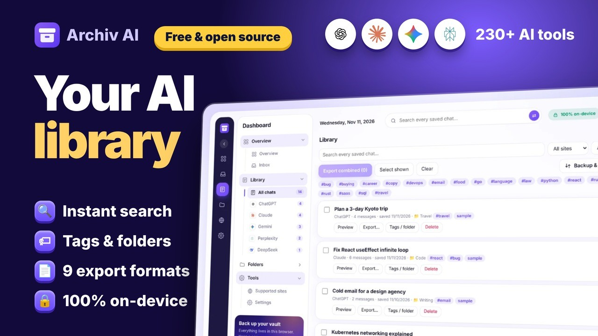

# Archiv AI: Chat Exporter & Library

Export ChatGPT, Claude, Gemini and 230+ other AI chats to **PDF, Word, image, Markdown, HTML, JSON, text, Notion and Obsidian**, and keep a private, searchable library on your own computer. No account, no server, no tracking.

**Website:** https://socialmania99.github.io/archiv-ai/ · **Privacy:** [docs/privacy.html](docs/privacy.html)

## Watch the walkthrough
[](https://youtu.be/EjymdaLmpWI)

▶ **[Watch on YouTube](https://youtu.be/EjymdaLmpWI)**: a two-minute tour of download, install, export, library, dashboard, backup and Notion. You can also play it embedded on the [website](https://socialmania99.github.io/archiv-ai/#video).

## Features
- **One-tab Inbox.** "Export this chat" sends a *recent copy from <tool>* to a single Archiv AI tab. Preview, Save to vault, Export or Discard.
- **Duplicate-aware saving.** Same chat again: identical copies are replaced; new messages are appended to the original and marked **Updated**.
- **Topic tags.** Up to four suggested tags per chat, editable.
- **Nine formats** from one menu, message selection, redaction of keys/tokens/emails/phones, themed and branded PDF.
- **Notion** (pages or database rows) and **Obsidian** (notes with frontmatter, callouts, ZIP per folder).
- **Library** with search, folders, tags, find-in-chat, backup/import, activity dashboard, light/dark, collapsible sidebar.
- **Platforms:** 239-tool directory (225 with logos), 15 hand-written adapters, auto-detect for any chat page, and Teach Archiv AI. Claude artifacts are appended (beta).

## Install
**From a release:** download `archiv-ai-*.zip` from [Releases](../../releases), unzip, open `chrome://extensions`, enable *Developer mode*, *Load unpacked*, choose the folder.

**From source:** clone this repo and *Load unpacked* on the repo root. Build a store zip with `bash tools/build-store.sh` (output in `dist/`).

Works in Chrome, Edge, Brave and other Chromium browsers. Open a chat, click the Archiv AI icon, or press `Alt+Shift+E`.

## Develop
Node.js 18+ and Playwright (Chromium) for the browser tests.
```bash
node test/unit.mjs            # unit tests
node test/e2e-inbox.mjs       # end-to-end suites (each launches Chromium with the extension)
```
Layout: `manifest.json`, `background.js` (service worker), `content/` (adapters, registry, content script), `lib/` (export, Notion, Obsidian, identity, topics, db), `dashboard.*` / `export.*` / `popup.*` (UI), `sidebar.*` (shared sidebar), `store/` (Web Store kit), `docs/` (GitHub Pages site), `tools/` (build scripts).

## Honest status
Built-in site selectors were written without access to live accounts and are not verified; sites change often. Use auto-detect or **Teach Archiv AI** when a page is missed, and please open an issue. Notion integration is tested against a mock API only.

## Privacy
Everything stays on your device. The only network call is *Send to Notion*, straight from your browser to `api.notion.com` with your own token. See the [privacy policy](docs/privacy.html).

## Trademarks
Archiv AI is independent and not affiliated with any AI company. Product names and logos belong to their owners and are used only to identify each service.

## License
MIT, see [LICENSE](LICENSE).
